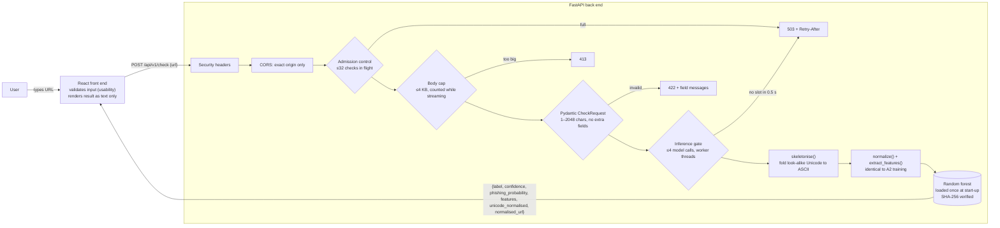

# PhishGuard: Secure Phishing URL Detection

**Session 7 Group 6 · Computing Technology Innovation Project · Assignment 3**
Team: Ellie Long (front end) · Puthisak Darith (back end) · Christopher Katsoulis (security, README)

PhishGuard lets someone paste a link they've been sent and find out, before they click it, whether it's phishing. A React front end sends the URL to a FastAPI back end. The back end normalises it exactly as our Assignment 2 pipeline did, extracts 16 lexical features and asks a random-forest model for a verdict. The user gets **phishing / legitimate** with a confidence score.

Every input to this application is potentially hostile, because its whole job is to receive links written by phishers. Security is the main focus of this assignment.

> **Defences to be marked (section 2.7):**
> 1. **Denial of service** (Advanced)
> 2. **Misconfiguration and vulnerable dependencies** (Intermediate)
>
> **Advanced security work to be marked (section 2.8):** **Detection evasion**, with look-alike Unicode measured before and after normalisation.

---

## 1. Running the application

Tested with Python 3.11–3.13 and Node 20+. Follow the steps below from a fresh clone.

### Back end

```bash
cd backend
python -m venv .venv
# macOS/Linux:  source .venv/bin/activate      Windows:  .venv\Scripts\activate
pip install -r requirements.txt
cp .env.example .env            # Windows: copy .env.example .env
uvicorn app.main:app --port 8000 --no-server-header
```

- API: <http://localhost:8000>
- Interactive docs: <http://localhost:8000/docs>
- The model file `backend/model/phishing_rf.joblib` (18 MB) is in the ZIP. To rebuild it, run `python train_model.py ../path/to/features_combined.csv.gz`, then paste the printed `MODEL_SHA256` into `.env`.

### Front end

```bash
cd frontend
npm ci
npm start                       # http://localhost:3000
```

The front end calls `http://localhost:8000/api/v1/check`. The address comes from `REACT_APP_API_URL` in `frontend/.env`; `cp .env.example .env` is optional because the code falls back to `http://localhost:8000`. The back end only accepts requests from the origin in `ALLOWED_ORIGINS` (default `http://localhost:3000`). If the back end runs on a different port, change `REACT_APP_API_URL`; if the front end does, change `ALLOWED_ORIGINS`.

### Tests and attack scripts (optional)

```bash
cd backend && pip install -r requirements-dev.txt
python -m pytest -q                                            # 22 tests
python ../attacks/dos_attack.py expensive                      # server must be running
python ../attacks/dos_attack.py flood
python ../attacks/evasion_demo.py
python ../attacks/evasion_attack.py ../path/to/features_combined.csv.gz
```

### Pinned dependency versions

| Package | Version | Package | Version |
|---|---|---|---|
| fastapi | 0.162.4 | scikit-learn | 1.5.2 |
| starlette | 1.10.0 | scipy | 1.14.1 |
| uvicorn[standard] | 0.54.0 | numpy | 2.1.3 |
| pydantic | 2.14.3 | pandas | 2.2.3 |
| pydantic_core | 2.50.4 | joblib | 1.6.0 |
| python-dotenv | 1.2.4 | *dev:* httpx 0.28.1, pytest 9.2.0, pip-audit 2.7.3 | |

Front-end versions are pinned by `frontend/package-lock.json` (`npm ci` installs exactly those).

---

## 2. Architecture



| File | Role |
|---|---|
| `app/main.py` | App, middleware order, three endpoints, OpenAPI docs |
| `app/schemas.py` | Pydantic request/response/error models with constraints |
| `app/errors.py` | One JSON error format for every failure, with no stack traces |
| `app/features.py` | `normalize` and `extract_features`, copied unchanged from the A2 notebook |
| `app/model.py` | Verifies the model hash, loads it once, predicts |
| `app/security/dos.py` | Body cap, admission control, inference gate |
| `app/security/headers.py` | Security headers (misconfiguration defence) |
| `app/security/unicode_norm.py` | `skeletonise()` (detection-evasion defence) |
| `attacks/` | The attack and measurement scripts we ran against our own app |
| `results/` | Raw outputs of those runs, referenced below |

### API

| Method | Path | Purpose | Success | Errors |
|---|---|---|---|---|
| POST | `/api/v1/check` | Classify one URL (creates a new computation, with a body) | 200 | 413, 422, 500, 503 |
| GET | `/api/v1/model-info` | Feature names and limits (available to clients; the current front end does not use it) | 200 | 500 |
| GET | `/api/v1/health` | Liveness check | 200 | |

Every error has the same shape:

```json
{"error": {"status": 422, "code": "validation_error", "message": "The request was not valid.",
           "fields": [{"field": "url", "message": "String should have at most 2048 characters"}]}}
```

Unknown paths return 404, wrong methods 405 and malformed JSON 422, all in this format. Unexpected exceptions are logged on the server and returned as a generic 500 with no internal details (`tests/test_api.py::test_unexpected_error_hides_details`).

### Front end (React + MUI v5)

| File | Role |
|---|---|
| `src/api.js` | The only file that calls the back end. It maps status codes (503, 422, 413) to friendly messages. 429 is also handled, in case a rate limit is added later; the back end does not currently return it |
| `src/pages/Home.js` | Holds state (loading, result, error, session history) and lays out the page |
| `src/components/UrlForm.js` | Input with validation before sending (empty, over 2,048 characters, spaces) |
| `src/components/ResultCard.js` | Verdict and confidence as the largest element on screen |
| `src/components/ConfidenceChart.js` | Chart 1: donut of phishing vs legitimate probability for the latest check |
| `src/components/HistoryPanel.js` | Chart 2: dot plot of every check this session, with filter and click-for-details |
| `src/components/ErrorNotFound.js` | Crash fallback page (the class inside is called `ErrorBoundary`) |
| `src/pages/NotFound.js` | 404 page for unknown addresses |
| `src/components/Reviews.js` | Sample reviews plus a form; visitor reviews are saved in that browser only (localStorage) |

React text rendering only, with no `dangerouslySetInnerHTML`. Checked URLs are shown as plain text, never as links. Every input has a label, controls work by keyboard, and the charts have a text equivalent plus a keyboard-usable list. The layout is responsive down to phone width. Session history lives in memory and clears on refresh. The three sample reviews were written by us for demonstration.

---

## 3. Threat model

**Who would attack PhishGuard?**
1. **A phisher** whose business depends on their links getting clicked. They have the most to gain: a checker that says "legitimate" is free credibility.
2. **Someone trying to knock the service over**, such as a rival or a bored attacker, or a phisher who wants it offline during a campaign so nobody can check their links.
3. **An opportunist scanning for weak servers.** They don't care about phishing at all and are looking for a debug page, an outdated library or a missing header to exploit.

**What are they trying to achieve?**
1. A malicious link **judged legitimate**, without making it look any different to the victim.
2. **Unavailability**, so real users get errors or endless spinners.
3. **A foothold**: running code on the server, or using it against our own users (clickjacking, script injection).

**What can they actually do?**
They can only send HTTP requests. They don't need our front end and can script `curl` directly. That means they control:
- every character of the URL, including Unicode that renders identically to ASCII;
- the size and shape of the request body, including bodies with no `Content-Length`;
- how many requests they send at once.

They can also read our `/docs`. They cannot read the server's files or memory.

**How this shaped our choices**

| Attacker goal | Risk it exposes | What we did |
|---|---|---|
| Link judged legitimate | **Detection evasion** (2.8): the model counts ASCII substrings like `login` and `.`, so `lоgin` with a Cyrillic `о` hides them | `skeletonise()` before feature extraction. Measured in §5 |
| Unavailability | **Denial of service** (2.7): one huge body, or many small ones | Body cap, admission control, worker-thread inference with a bounded gate. Measured in §4.1 |
| Foothold | **Misconfiguration / vulnerable dependencies** (2.7): headers absent by default, old Starlette with known CVEs | Security headers, no server banner, pinned and audited dependencies. §4.2 |
| Foothold | **Unsafe model loading**: joblib is pickle, which can run code | SHA-256 check before `joblib.load`; refuses to start on a mismatch. Hygiene, not marked |

**Risks from section 2.7 that do not apply to this design**
- **SSRF:** the back end never fetches, resolves or looks up the submitted URL. It only analyses the string, so there is no outbound request to forge. This is deliberate: fetching a phishing page would also expose our server to it.
- **Command injection:** no system command is ever run (no `whois`, no shell).
- **SQL injection:** there is no database. Session history lives in the browser only.
- **Unsafe file upload:** the API accepts only a JSON body with one string field. There is no file upload.
- **Broken access control and login timing:** there are no user accounts.
- **Rate limiting:** a per-IP limiter would mainly stop the detector being probed. Our admission control already bounds total load, so we chose two defences that answer our attacker's goals more directly.

### Security hygiene (section 2.3)

| Requirement | How it is met on the back end |
|---|---|
| User input never rendered as HTML | The API returns JSON only, with a strict `Content-Security-Policy: default-src 'none'` and `X-Content-Type-Options: nosniff`. Characters that are never valid unencoded in a URL (`< > " \``, spaces, control characters) are rejected with 422. Front end: React text rendering only, no `dangerouslySetInnerHTML`. The checked URL is shown as **plain text, never as a clickable link**, since clicking it would defeat the purpose. |
| Size limits on the back end | Body ≤ 4,096 bytes (streamed count, 413); URL 1–2,048 characters (Pydantic, 422). 2,048 is the practical URL length limit across browsers and servers. In our 805,357-row dataset, 99.99% of URLs are under 900 characters and only 6 are longer than 2,048. |
| CORS only for our front end | `allow_origins` comes from `ALLOWED_ORIGINS` (exact origin, never `*`). Only GET/POST and the `Content-Type` header are allowed, with no credentials. A preflight from another origin gets no `Access-Control-Allow-Origin` (tested). |
| Secrets out of source code | All configuration comes from environment variables or `.env`, which is git-ignored. `.env.example` holds no secrets. The model hash is not a secret but is kept out of the code so it can be updated without a code change. |

---

## 4. Section 2.7 defences

### 4.1 Denial of service (Advanced)

**The attack.** Running a request costs our server far more than it costs the attacker to send one. We found two concrete ways to exploit that:

- **One expensive request.** Pydantic's `max_length` runs only after FastAPI has read the whole body into memory and parsed it as JSON, on the single event loop. A 150 MB body (`{"url": "aaaa…"}`) takes the attacker one `curl` command. The server spends ~0.7 s reading and parsing it, during which **every other user waits**. It then answers 422.
- **A flood.** 3,000 `/check` requests with 300 in flight. With no limit, every request is accepted and queued, so the queue and every user's waiting time grow without bound.

**The defence** (`app/security/dos.py`, wired up in `app/main.py`):
1. **`BodySizeLimitMiddleware`** rejects any body over 4 KB *while it is still arriving*: by `Content-Length`, and by counting streamed bytes for chunked bodies that send no length. It answers 413 and stops reading. *Variations covered:* missing `Content-Length` (chunked), a false `Content-Length`, and an invalid `Content-Length` (uvicorn rejects it with 400).
2. **`AdmissionControlMiddleware`** allows at most 32 `/check` requests in flight. The 33rd gets **503 + `Retry-After: 1`** before its body is even read. Turning a request away early is what keeps a flood cheap. `/health` and `/docs` aren't counted, so they stay responsive.
3. **`InferenceGate`** runs the model in a worker thread, so a slow call can't freeze the event loop. At most 4 model calls run at once, and a request that can't get a slot within 0.5 s gets 503 instead of waiting forever.

**The proof** (`attacks/dos_attack.py`, 3 runs each, raw output in `results/dos_results.txt`). A separate "victim" process calls `/health` every 50 ms during the attack. It runs in its own process so the attacker's CPU load can't distort its timings.

| Attack | Measure | Defence OFF | Defence ON |
|---|---|---|---|
| One 150 MB body | Server time spent on the attack request | 658–721 ms (then 422) | **23–24 ms** (413, connection closed) |
| | Victim worst-case wait | **528–572 ms** | 25–32 ms |
| 3,000 requests, 300 in flight | Victim worst-case wait | **805–1,166 ms** | 24–72 ms |
| | Victim p95 | 31–63 ms | 10–15 ms |
| | Excess rejected with 503 | 0 (everything queued) | 281–359 |

Baseline victim latency with no attack: median ≈ 2.2 ms.

**What it costs.**
- When the server is genuinely busy, some *legitimate* checks are refused with 503 rather than served slowly. The front end has to show a clear "busy, try again" message.
- 4 KB rules out a JSON body with anything except one URL, which is all our API needs.
- The limits (32 / 4 / 0.5 s) are tuned for a 2-core laptop. A bigger machine would raise them through `.env` without code changes.

**Limits.** This defends against requests that are expensive per byte sent. It does not stop a distributed flood from many machines, which has to be handled upstream (a CDN or the hosting provider), as the specification notes. Slow-loris style trickling is bounded by uvicorn's timeouts, not by our code.

### 4.2 Misconfiguration and vulnerable dependencies (Intermediate)

**The attack.**
- `pip-audit` on the first version of our back end found **8 known vulnerabilities**: 7 in Starlette 0.41.3 and 1 in python-dotenv 1.0.1 (`results/pip_audit_before.txt`).
- FastAPI sends **no security headers** by default.
- uvicorn announces itself in a `server: uvicorn` banner.

**The defence.**
- Upgraded to FastAPI 0.162.4 / Starlette 1.10.0 / python-dotenv 1.2.4. `pip-audit` now reports **no known vulnerabilities** in both `requirements.txt` and `requirements-dev.txt` (`results/pip_audit_after.txt`). All 22 tests pass on the new versions.
- `SecurityHeadersMiddleware` (`app/security/headers.py`) adds:
  - `Content-Security-Policy` (`default-src 'none'` for the JSON API, and a narrow policy for `/docs`, which needs Swagger's CDN)
  - `X-Content-Type-Options: nosniff`
  - `X-Frame-Options: DENY`
  - `Referrer-Policy: no-referrer`, so the checked URL never leaks in a Referer header
  - `Permissions-Policy`
  - `Cross-Origin-Opener-Policy` and `Cross-Origin-Resource-Policy`
  - `Cache-Control: no-store`
  - HSTS when served over HTTPS
- The server banner is removed (`--no-server-header`, and the middleware strips any `server` header).
- No debug mode. `/redoc` is disabled because it isn't used. Errors never include stack traces.

**ZAP and npm audit, run on our own machine:**
<!-- TODO: paste the results here after running them. -->

```bash
# OWASP ZAP baseline scan of the running API (Docker)
docker run --rm -t ghcr.io/zaproxy/zaproxy:stable zap-baseline.py -t http://host.docker.internal:8000/docs
# Front end dependencies
cd frontend && npm audit
```

| Finding | Before | After / justification |
|---|---|---|
| Starlette 0.41.3, 7 advisories | Present | Fixed (1.10.0) |
| python-dotenv 1.0.1, PYSEC-2026-2270 | Present | Fixed (1.2.4) |
| Missing CSP / X-Content-Type-Options / anti-clickjacking headers | Present | Fixed (headers middleware) |
| Server banner disclosure | Present | Fixed |
| `/docs` CSP allows `'unsafe-inline'` scripts and styles | n/a | Accepted: Swagger UI starts from an inline script and uses inline styles. `/docs` takes no user input, and every API response has `default-src 'none'` |
| ZAP / npm audit findings | *(fill in)* | *(fill in)* |

**What it costs.** Upgrading Starlette across a major version risked breaking changes. We re-ran the full test suite and every attack afterwards to confirm nothing broke. The strict CSP means the API can never be used to serve a page, which is fine because it only serves JSON.

---

## 5. Section 2.8: detection evasion, measured before and after

**The attack.** Our features are ASCII string counts: does the URL contain `login`, `paypal` or `.tk`, and how many dots? A phisher can change what the model sees without changing what a person sees:

| Disguise | Example | Looks like |
|---|---|---|
| homoglyph | `kuсоіnӏоgіn…` (Cyrillic с о і ӏ) | `kucoinlogin…` |
| zero_width | `lo​gin` (invisible space) | `login` |
| fullwidth | `webflow．io` (U+FF0E), which browsers treat as `.` | `webflow.io` |
| punycode | `xn--kungnu-8nf…`, the form a browser sends for a homoglyph host | |
| adaptive | the attacker tries all four and keeps any that evades | |

**Method** (`attacks/evasion_attack.py`):
- We take phishing URLs that the model **never saw in training** (outside its 200,000-row training sample) and that it **correctly flags**.
- For each of **5 random seeds** we take 1,000 such URLs, apply every disguise and record the **evasion rate**: the share now classed *legitimate*.
- We run three pipelines:
  - no defence (the A2 pipeline);
  - the obvious fix, NFKC normalisation alone;
  - our full defence.

**The defence** (`app/security/unicode_norm.py`, `skeletonise()`):
1. Percent-decode, so `%D0%B0` can't hide a Cyrillic `а`.
2. Drop invisible format characters (Unicode category `Cf`).
3. Apply NFKC (fullwidth to ASCII).
4. Decode punycode host labels back to Unicode.
5. Strip accents.
6. Map look-alike Cyrillic, Greek and Armenian letters to ASCII, using the Unicode TS #39 confusables.

The model then sees the same features as for the undisguised URL.

**Results** (mean ± sd over 5 seeds × 1,000 URLs; raw data in `results/evasion_results.json`):

| Disguise | No defence | NFKC only | **skeletonise** |
|---|---|---|---|
| homoglyph | 4.8 ± 0.8 % | 4.8 ± 0.8 % | **0.0 ± 0.1 %** |
| zero_width | 4.6 ± 0.4 % | 4.6 ± 0.4 % | **0.1 ± 0.1 %** |
| fullwidth | **70.0 ± 0.6 %** | 0.0 ± 0.0 % | **0.1 ± 0.1 %** |
| punycode | 16.2 ± 0.8 % | 16.2 ± 0.8 % | **0.0 ± 0.1 %** |
| **adaptive** | **80.1 ± 0.3 %** | **21.0 ± 0.8 %** | **0.1 ± 0.1 %** |

**Interpretation.**
- Without the defence, an attacker willing to try four disguises gets **4 in 5** caught phishing links past the model.
- Fullwidth dots are by far the strongest disguise: they change the dot, subdomain and top-level-domain features all at once.
- Homoglyphs alone succeed less often than we expected (~5%). Most of the model's signal comes from length and structure features that homoglyphs don't change.
- **The obvious fix is not enough.** NFKC folds fullwidth characters but leaves Cyrillic letters, zero-width spaces and punycode alone, so an adaptive attacker still evades 21% of the time.
- Our skeleton brings every disguise to ≤0.1%, which is indistinguishable from zero across the seeds.
- Live demo: `attacks/evasion_demo.py` shows one held-out phishing URL flipping from *phishing* (0.709) to *legitimate* (0.18–0.27) under three disguises with the defence off, and back to *phishing* with it on (`results/evasion_demo_off.txt`, `results/evasion_demo_on.txt`).

**What it costs.**
- **False positives:** on 20,000 held-out legitimate URLs, the false-positive rate is **2.64% without vs 2.63% with** the defence (682 of them were altered by normalisation). No measurable cost.
- **Information loss for genuine international domains:** `münchen.de` is analysed as `munchen.de`, and `россия.рф` as a meaningless mix of letters. The verdict for these is based on a folded form, not what the user typed. We accept this because the model's features are ASCII-only anyway. The response flags this with `unicode_normalised: true` and returns the cleaned URL as `normalised_url`. The front end shows that cleaned URL as "URL checked"; it does not currently show a separate warning that the URL was altered.
- **Speed:** about 15 µs per URL, under 1% of the ~2 ms inference time.

**Limits.**
- The confusables map covers the scripts attackers most commonly use, not all of Unicode. A missed look-alike would evade.
- This defends against *disguising* a URL. It does nothing against a phisher who simply registers a domain whose features already look benign. That is a model-quality problem, which this assignment doesn't mark.

---

## 6. What doesn't work yet, and what we'd do next

- **The model is weak.** It has 62% recall on phishing in our held-out split, and some obvious phishing URLs score as legitimate. Accuracy isn't marked here, but a gradient-boosted model or character n-gram features would be the next step.
- **Distributed floods** need protection upstream (a CDN or the hosting provider).
- **Mixed-script hosts** (Latin plus Cyrillic in one label) are themselves strong evidence of phishing. Adding a "mixed script" feature and retraining would let the model use that signal, not just undo the disguise.
- **Reviews are not shared between visitors.** Reviews a visitor adds are stored in that browser only (localStorage). Sharing them would need a back-end endpoint with size limits, rate limiting and storage, which we did not build. The three sample reviews were written by us.
- **Session history is lost on refresh.** It is kept in memory only, and capped at the 20 most recent checks.
- **Placeholder contact details.** The email and phone number in the footer are placeholders.
- **No automated front-end tests.** We tested the interface by hand, including keyboard use and a phone-sized window.
- - **No warning when a URL was altered.** For URLs with look-alike characters, the result card shows the cleaned version without saying it was changed. A visible notice based on `unicode_normalised` would be the next step.

---

## 7. References

Davis, M. and Suignard, M. (2023) *Unicode Technical Standard #39: Unicode Security Mechanisms*. Unicode Consortium. Available at: https://www.unicode.org/reports/tr39/ (Accessed: 11 November 2026).

Gabrilovich, E. and Gontmakher, A. (2002) 'The homograph attack', *Communications of the ACM*, 45(2), p. 128.

Le Pochat, V., Van Goethem, T., Tajalizadehkhoob, S., Korczyński, M. and Joosen, W. (2019) 'Tranco: a research-oriented top sites ranking hardened against manipulation', in *Proceedings of the Network and Distributed System Security Symposium (NDSS)*. San Diego: Internet Society.

OWASP Foundation (2021) *OWASP Top 10: 2021*. Available at: https://owasp.org/Top10/ (Accessed: 11 November 2026).

OWASP Foundation (2026) *ZAP baseline scan*. Available at: https://www.zaproxy.org/docs/docker/baseline-scan/ (Accessed: 11 November 2026).

Pedregosa, F. *et al.* (2011) 'Scikit-learn: machine learning in Python', *Journal of Machine Learning Research*, 12, pp. 2825–2830.

PhishTank (2026) *PhishTank: out of the net, into the tank*. Available at: https://phishtank.org/ (Accessed: 11 November 2026).

Python Packaging Authority (2026) *pip-audit*. Available at: https://github.com/pypa/pip-audit (Accessed: 11 November 2026).

Ramírez, S. (2026) *FastAPI documentation*. Available at: https://fastapi.tiangolo.com/ (Accessed: 11 November 2026).

Whistler, K. (ed.) (2024) *Unicode Standard Annex #15: Unicode Normalization Forms*. Unicode Consortium. Available at: https://www.unicode.org/reports/tr15/ (Accessed: 11 November 2026).

<!-- TODO: add the base dataset citation exactly as in our Assignment 2 report (malicious_phish.csv). -->

---

## 8. Use of generative AI

<!-- TODO: each member should edit this so it is accurate for their own part. -->
We used **Claude (Anthropic)** for the security part and frontend of this assignment:
- drafting the threat model;
- writing the security middleware (`app/security/`), the error handling, the tests and the attack/measurement scripts in `attacks/`;
- running the measurements;
- drafting this README.
- draft react component
- debug errors
- write and explain code comments

We reviewed, ran and tested all of this code ourselves, re-ran every measurement on our own machine before recording, and can explain every part of it in the video. The A2 feature-extraction code in `app/features.py` is our own work from Assignment 2, copied unchanged.
